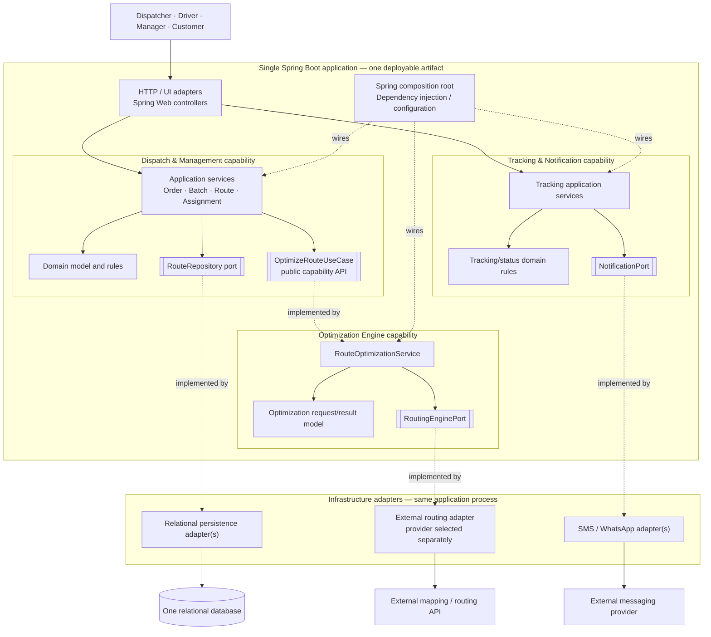

# Lab 7 — Component Architecture

## 1. Architectural overview

The Logistics Route Decider System is a **single-deployment, capability-oriented modular monolith**. The diagram shows logical components and dependency direction; it does not imply separate processes or deployable services.

The system has three business capabilities:

- **Dispatch & Management:** orders, delivery batches, route review/approval, driver and vehicle assignment, and manager dashboard queries.
- **Optimization Engine:** route optimization use cases and integration with an external routing/geospatial provider.
- **Tracking & Notification:** driver route/status updates and outbound notifications.

## 2. Component diagram

## 3. Responsibilities and contracts

| Component | Responsibility | Main contracts / dependencies |
|---|---|---|
| HTTP / UI adapters | Authenticate/validate requests and translate transport models to use cases | Dispatch and Tracking application interfaces |
| Dispatch application services | Coordinate order, batch, route review, approval, and assignment workflows | Domain model, `RouteRepository`, `OptimizeRouteUseCase` |
| Dispatch domain | Enforce order, route, capacity, and assignment invariants | Plain Java; no framework dependency |
| `OptimizeRouteUseCase` | Public interface through which Dispatch requests optimization | Optimization capability contract |
| Optimization application service | Execute optimization use case and coordinate routing request | Optimization model and `RoutingEnginePort` |
| `RoutingEnginePort` | Hide provider-specific routing/geospatial API details | Implemented by an infrastructure adapter |
| Tracking application services | Accept driver progress/status changes and query route state | Tracking domain, repositories as needed, `NotificationPort` |
| `NotificationPort` | Hide outbound messaging provider details | Implemented by an infrastructure adapter |
| Relational persistence adapters | Map domain/repository operations to relational storage | Capability-owned repository ports |
| Spring composition root | Construct and wire services and adapter implementations | Spring configuration/DI |
 
## 4. Dependency rules

1. Dependencies point from transport/infrastructure adapters toward application use cases and from application services toward domain models and capability-owned ports.
2. Domain models, application services, and ports are plain Java. They must not import Spring, persistence implementation packages, or provider SDK types.
3. Infrastructure adapters implement ports owned by the consuming capability. Provider-specific request/response types stay inside the adapter.
4. Dispatch depends on the Optimization capability's `OptimizeRouteUseCase`, never on `RouteOptimizationService` or another optimizer implementation class.
5. The composition root is the only place that knows the concrete service and adapter implementations that must be wired together.
6. Capability-to-capability calls are in-process. Local events may be used for secondary effects; Phase 1 does not require a message broker.

## 5. Deployment and data view

- One Spring Boot application artifact and one application process in the Phase 1 deployment model.
- One relational database shared through capability-owned repository ports; consistency-sensitive operations use local transactions.
- External routing/geospatial and messaging APIs are remote dependencies, not internal microservices.
- Optimization may run on bounded, managed worker threads. This is an execution strategy inside the monolith, not a separately deployed Optimization service.
- External routing calls use finite timeouts. A failed provider call must not create or persist a fabricated route result; preserve the last valid route state and return a clear failure.
- Concurrent route/driver assignment is protected with database transactions and optimistic version checks.

## 6. Traceability

The component-to-quality mapping is in [quality-to-architecture.md](../docs/quality-to-architecture.md). The architecture decision and alternatives are documented in [ADR-001](../decisions/ADR-001-architecture.md) and [architecture-options.md](../docs/architecture-options.md). The framework boundary is specified in [ADR-002](../decisions/ADR-002-framework.md).
