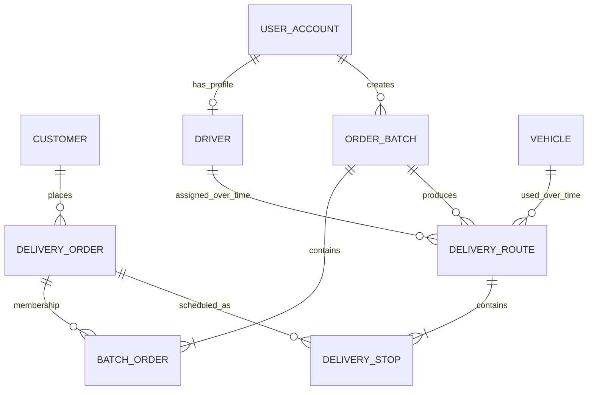

# Logical Data Model

This model describes the persistent entities needed for batch-based route optimization and subsequent assignment. Primary keys are marked **PK** and foreign keys **FK**. The primary relational database is authoritative; its replica is read-only.

## Entities and attributes

| Entity | Key and important attributes | Constraints |
|---|---|---|
| **Customer** | customer_id **PK**, name, phone, email | A customer may own multiple delivery orders. |
| **DeliveryOrder** | order_id **PK**, customer_id **FK**, delivery_address, latitude, longitude, window_start, window_end, payload_weight, payload_volume, status, version | customer_id references Customer. Coordinates and payload values must be valid; window_start < window_end; weight and volume >= 0. |
| **OrderBatch** | batch_id **PK**, created_by_user_id **FK**, status, created_at, version | created_by_user_id references UserAccount. Batch status follows the defined lifecycle. |
| **BatchOrder** | batch_id **PK/FK**, order_id **PK/FK**, added_at | Composite PK prevents the same order being added twice to one batch. order_id is unique if an order may belong to only one active batch; enforce this as a filtered/partial unique constraint where supported, or transactionally in the service. |
| **Driver** | driver_id **PK**, user_id **FK**, license_number, max_shift_minutes, status, version | user_id references UserAccount and is unique. Driver status and version are checked during assignment. |
| **Vehicle** | vehicle_id **PK**, registration_number, max_payload_weight, max_payload_volume, active, status, version | registration_number unique; capacity values > 0. |
| **DeliveryRoute** | route_id **PK**, batch_id **FK**, driver_id **FK** nullable until assignment, vehicle_id **FK**, status, total_distance, estimated_duration, created_at, version | batch_id references OrderBatch; driver_id and vehicle_id reference their entities. A batch may have route revisions, but only one current non-cancelled route may be selected for dispatch. |
| **DeliveryStop** | stop_id **PK**, route_id **FK**, order_id **FK**, sequence_no, eta, reachable | route_id references DeliveryRoute; order_id references DeliveryOrder; UNIQUE(route_id, sequence_no); UNIQUE(route_id, order_id). |
| **UserAccount** | user_id **PK**, username, password_hash, role, active | username unique; role is constrained to supported roles. |

## Relationship cardinalities

- Customer **1** — **0..*** DeliveryOrder. Every order belongs to exactly one customer.
- UserAccount **1** — **0..1** Driver. A driver profile belongs to one user account; a user may have no driver profile.
- UserAccount **1** — **0..*** OrderBatch. Each batch has exactly one creator.
- OrderBatch **1** — **1..*** BatchOrder; DeliveryOrder **1** — **0..*** BatchOrder over its history. BatchOrder resolves the many-to-many membership relationship.
- OrderBatch **1** — **0..*** DeliveryRoute (route revisions); each route belongs to exactly one batch.
- Driver **1** — **0..*** DeliveryRoute over time; a route has **0..1** driver before assignment and exactly one driver when dispatched.
- Vehicle **1** — **0..*** DeliveryRoute over time; each route has exactly one selected vehicle.
- DeliveryRoute **1** — **1..*** DeliveryStop; each stop belongs to exactly one route.
- DeliveryOrder **1** — **0..*** DeliveryStop over route revisions; each stop references exactly one order.

## Lifecycle and integrity notes

- OrderBatch: Draft -> Optimized -> Dispatched -> Completed; cancellation is allowed only through an explicit permitted transition.
- DeliveryRoute: Optimized -> Approved -> Dispatched -> InProgress -> Completed; rejected/cancelled routes are retained as history rather than overwritten.
- A route in Optimized state is a proposal; the driver is not considered assigned until the dispatch/assignment transaction succeeds.
- Enforce one active assignment per driver and vehicle with a database uniqueness mechanism where supported, backed by a transaction and optimistic version checks.
- Enforce that an order cannot appear in two simultaneously active routes. Historical route stops may remain for audit.
- Route stop sequence numbers are unique within a route and positive. ETA values must satisfy the order delivery window before approval.
- All state-changing writes go to the primary database. The replica is not writable and may be used only for stale-tolerant reads.
- Use foreign keys and check constraints for row-level invariants; use a transaction for multi-entity state transitions and service-level validation for aggregate constraints such as total route capacity.
- The model does not introduce a separate DeliveryNode table: delivery location details belong to DeliveryOrder; API-level node identifiers must map to a stable order/stop identifier rather than a second source of truth.

## ER diagram

